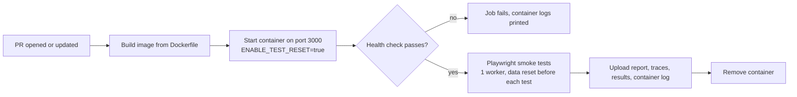

# PR open: container run

This project does one thing when a pull request is opened or updated: **build the Docker image, start it as a container, and run the Playwright smoke tests against that container.** The job fails if any step fails.

It deliberately excludes the other PR-open check (running the app from source with per-worker servers), and Jenkins, staging and post-deploy checks. Those live elsewhere so each pipeline's output stays easy to read.

## What happens



1. `./build.sh container-up` builds `qg-container:ci`, starts it as `qg-container` on port 3000, and polls `/health` for up to about a minute. It also checks that `/api/runs` contains the seeded run `Login Flow`.
2. Playwright installs Chromium and runs `--grep @smoke` against `http://localhost:3000`.
3. Artifacts are uploaded whether or not the tests passed, then the container is removed.

The workflow is [.github/workflows/pr-open-container.yml](.github/workflows/pr-open-container.yml), job name `e2e-container`. Make that job a required status check in branch protection if it should block merges.

## Run it locally

Needs Docker, Node 22+ (24 recommended), pnpm, and Git Bash or WSL on Windows. Port 3000 must be free.

```
pnpm install --frozen-lockfile
pnpm --filter ai-ci-reference-e2e exec playwright install chromium   # once

./build.sh container-up                       # build, start, wait for health
pnpm --filter ai-ci-reference-e2e test:smoke  # what the PR job runs
pnpm --filter ai-ci-reference-e2e test        # full suite (optional)
./build.sh container-down                     # always clean up
```

Open http://localhost:3000 while the container is up to see the app.

## What is tested

| Suite | Tests | Command |
|---|---|---|
| Smoke (the PR job) | 3: dashboard shows the seeded runs, a created run persists after reload, API health | `test:smoke` |
| Full | 16 plus 1 deliberately skipped demo failure | `test` |

## Test data and isolation

- All tests share the single container and its database, so Playwright runs with **one worker** (set in `e2e/playwright.config.ts`).
- Before every test, an automatic fixture calls `POST /api/test/reset` to restore the seed data. If the endpoint is disabled it fails immediately with "the container must be started with ENABLE_TEST_RESET=true".
- `ENABLE_TEST_RESET=true` is set only on this test container, never in a deployed environment.

## Artifacts

| Where | What | Produced |
|---|---|---|
| `e2e/playwright-report/` | HTML report (`pnpm --filter ai-ci-reference-e2e exec playwright show-report`) | Every run |
| `e2e/test-results/junit.xml` | Machine-readable results | Every run |
| `e2e/test-results/<test>/` | Screenshot, `trace.zip`, `error-context.md` | Failed tests only |
| CI log step "Container logs" | The container's stdout and stderr | Every run |

In GitHub Actions, the report and results are uploaded as the artifact `playwright-diagnostics` (kept 7 days). Open a trace with `pnpm --filter ai-ci-reference-e2e exec playwright show-trace <trace.zip>`.

## Troubleshooting

- **"Container did not become healthy":** read the container logs printed by the step, or run `docker logs qg-container`.
- **Port 3000 already in use:** stop whatever is using it, or run `./build.sh container-down` if it is a leftover container from an earlier run.
- **Tests fail on data counts:** the container was probably reused. Run `./build.sh container-down` and start again.
- **Reset assertion fails:** the container was started without `ENABLE_TEST_RESET=true`. Use `./build.sh container-up`.
