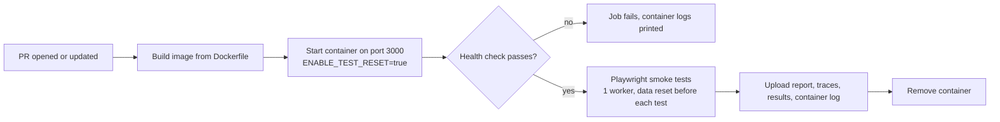

# PR open: container run

This project does one thing when a pull request is opened or updated: **build the Docker image, start it as a container, and run the Playwright smoke tests against that container.** The job fails if any step fails.

It deliberately excludes the other PR-open check (running the app from source with per-worker servers), and Jenkins, staging and post-deploy checks. Those live elsewhere so each pipeline's output stays easy to read.

## What happens



1. `./build.sh container-up` builds `qg-container:ci`, starts it as `qg-container` on port 3000, and polls `/health` for up to about a minute. It also checks that `/api/runs` contains the seeded run `Login Flow`.
2. Playwright installs Chromium and runs `--grep @smoke` against `http://localhost:3000`.
3. Artifacts are uploaded whether or not the tests passed, then the container is removed.

The workflow is [.github/workflows/pr-open-container.yml](.github/workflows/pr-open-container.yml), job name `e2e-container`. Make that job a required status check in branch protection if it should block merges.

## Setup requirements (greenfield checklist)

What a new project needs before this flow can work:

**Repository and hosting**
- A GitHub repo whose default branch is `main` (the workflow triggers on PRs to `main`) with GitHub Actions enabled.
- A branch ruleset on `main` that requires the `e2e-container` check (Github web UI: Settings > Rules > Rulesets > New ruleset > New Branch Ruleset), with an empty bypass list so admins cannot skip it. The check name appears only after the first workflow run.
- A way to push: a browser sign-in through Git Credential Manager, or a token with Contents and Workflows write access.

**Tooling**
- Docker, to build and run the image locally. GitHub's `ubuntu-latest` runners already include it.
- Node 22+ (24 recommended) and pnpm on the host, because Playwright runs outside the container. Pin the pnpm version in the root `package.json` (`packageManager`), since the workflow reads it from there.
- Git Bash or WSL on Windows, to run `build.sh`. No secrets are needed.

**Repository layout**
- A pnpm workspace: `pnpm-workspace.yaml` listing the packages (`apps/*`, `e2e`), one committed `pnpm-lock.yaml`, and a `package.json` per package.
- `apps/web` (React and Vite) and `apps/api` (Express and SQLite), each with the build scripts that write `dist/`.
- A single task entry point, `build.sh`, committed with its executable bit and LF line endings. It holds the `container-up` and `container-down` tasks that CI and local runs share.
- `.gitignore` (`node_modules`, `dist`, `data`, `test-results`, `playwright-report`, `.env`), `.gitattributes` (LF endings), and `.dockerignore` (keeps `node_modules`, `dist`, `.git` and test output out of the image build).

**The image**
- A multi-stage `Dockerfile`: one stage installs and builds the web app and API, and a slim runtime stage installs only production dependencies and copies in the built output.
- The workspace manifests (including `e2e/package.json`) copied into both stages, so `pnpm install --frozen-lockfile` matches the lockfile.
- Runtime defaults as environment variables (`PORT`, `DB_PATH`, `WEB_DIST`), a non-root user, `EXPOSE 3000`, and a `HEALTHCHECK` against `/health`.

**What the app must provide for testing**
- A `/health` endpoint, so the container can be waited on.
- Seed data that is the same on every start. The container has no volume, so every run starts from a fresh database.
- A test-only reset endpoint that is off unless `ENABLE_TEST_RESET=true`, which only the CI test container sets.

**Tests**
- E2E tests: `@playwright/test` in `e2e/`, with `ui` and `api` projects, `@smoke` and `@regression` tags, HTML and JUnit reporters, and traces kept on failure.
- Playwright config with `workers: 1` and `fullyParallel: false`, because all tests share one container and database, plus a default `baseURL` of `http://localhost:3000`.
- A fixture that resets the data before every test and fails with a clear message if the reset endpoint is disabled.

**CI workflow**
- `.github/workflows/pr-open-container.yml`: trigger on `pull_request` to `main`, read-only `permissions`, and `concurrency` so a new push cancels the old run.
- Steps in order: checkout, pnpm, Node with the pnpm cache, `./build.sh container-up`, install the e2e dependencies, Chromium, smoke tests with `BASE_URL`, upload the report, print the container logs, remove the container (`if: always()`).

## Run it locally

Needs Docker, Node 22+ (24 recommended), pnpm, and Git Bash or WSL on Windows. Port 3000 must be free.

```
pnpm install --frozen-lockfile
pnpm --filter ai-ci-reference-e2e exec playwright install chromium   # once

./build.sh container-up                       # build, start, wait for health
pnpm --filter ai-ci-reference-e2e test:smoke  # what the PR job runs
pnpm --filter ai-ci-reference-e2e test        # full suite (optional)
./build.sh container-down                     # always clean up
```

Open http://localhost:3000 while the container is up to see the app.

## What is tested

| Suite | Tests | Command |
|---|---|---|
| Smoke (the PR job) | 3: dashboard shows the seeded runs, a created run persists after reload, API health | `test:smoke` |
| Full | 16 plus 1 deliberately skipped demo failure | `test` |

## Test data and isolation

- All tests share the single container and its database, so Playwright runs with **one worker** (set in `e2e/playwright.config.ts`).
- Before every test, an automatic fixture calls `POST /api/test/reset` to restore the seed data. If the endpoint is disabled it fails immediately with "the container must be started with ENABLE_TEST_RESET=true".
- `ENABLE_TEST_RESET=true` is set only on this test container, never in a deployed environment.

## Artifacts

| Where | What | Produced |
|---|---|---|
| `e2e/playwright-report/` | HTML report (`pnpm --filter ai-ci-reference-e2e exec playwright show-report`) | Every run |
| `e2e/test-results/junit.xml` | Machine-readable results | Every run |
| `e2e/test-results/<test>/` | Screenshot, `trace.zip`, `error-context.md` | Failed tests only |
| CI log step "Container logs" | The container's stdout and stderr | Every run |

In GitHub Actions, the report and results are uploaded as the artifact `playwright-diagnostics` (kept 7 days). Open a trace with `pnpm --filter ai-ci-reference-e2e exec playwright show-trace <trace.zip>`.

## Troubleshooting

- **"Container did not become healthy":** read the container logs printed by the step, or run `docker logs qg-container`.
- **Port 3000 already in use:** stop whatever is using it, or run `./build.sh container-down` if it is a leftover container from an earlier run.
- **Tests fail on data counts:** the container was probably reused. Run `./build.sh container-down` and start again.
- **Reset assertion fails:** the container was started without `ENABLE_TEST_RESET=true`. Use `./build.sh container-up`.
