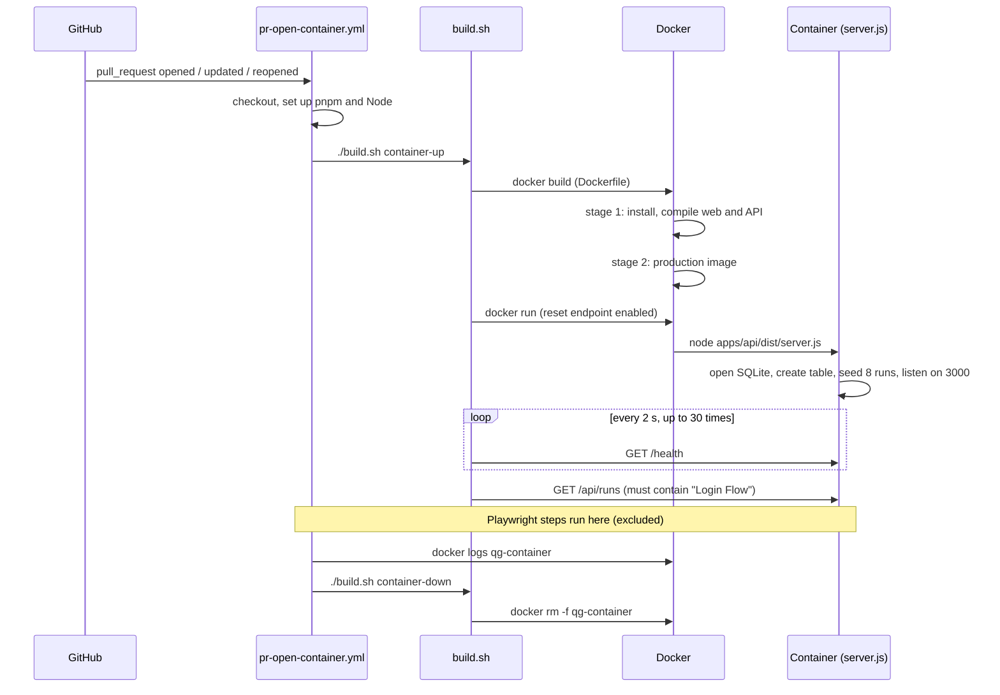

# Verbose: PR open, container path (CI only)

This expands the "What happens" section of [README.pr-open-container.md](README.pr-open-container.md). It follows the code path of the CI job and names every file and line that runs. The Playwright steps are left out and marked where they would sit.

## The path at a glance

## Step by step

### 0. Trigger and job setup
[.github/workflows/pr-open-container.yml](.github/workflows/pr-open-container.yml)

- Lines 3-5: runs on `pull_request` events (opened, new commits, reopened) targeting `main`.
- Lines 7-9: a new push to the same PR cancels the run in progress.
- Lines 11-12: the job gets read-only repository access.
- Lines 15-18: one job, `e2e-container`, on `ubuntu-latest`, with a 15-minute timeout. This job name is what branch protection would require.

### 1. Runner preparation
Same workflow file.

- Line 20: `actions/checkout` puts the PR's merge commit on the runner.
- Line 23: `pnpm/action-setup` installs pnpm at the version in [package.json](package.json#L8) (`packageManager`).
- Lines 25-28: `actions/setup-node` installs Node 24 and enables the pnpm cache.

`container-up` itself does not use the runner's Node or pnpm, because the image brings its own. Those two steps exist for the Playwright steps later.

### 2. Build the image and start the container
Workflow lines 30-31 run `./build.sh container-up`.

[build.sh](build.sh):
- Lines 1-4: strict mode (`set -euo pipefail`, so any failing command fails the script), then move to the script's own folder.
- Line 11: task selection, then the `container-up` case on lines 22-37.
- Line 24: `docker build -t qg-container:ci .` builds the image from [Dockerfile](Dockerfile). Files listed in [.dockerignore](.dockerignore) (`node_modules`, `dist`, `data`, `.git`, `.github`, test output) are not sent to Docker.

#### 2a. Dockerfile, stage 1 (`build`)
- Lines 1-3: a Node 24 image, pnpm 12.14.0 (the same version as `package.json`), working folder `/app`.
- Lines 4-7: copy only the manifests: root `package.json`, `pnpm-lock.yaml`, `pnpm-workspace.yaml`, and the `package.json` of `apps/api`, `apps/web` and `e2e`. The `e2e` manifest is needed because [pnpm-workspace.yaml](pnpm-workspace.yaml#L1-L3) lists it and the lockfile includes it. Copying manifests first lets Docker cache the install layer.
- Line 8: `pnpm install --frozen-lockfile --filter "@qgl/*"` installs the web and API packages, including dev tools (TypeScript, Vite) and skipping `e2e`. [pnpm-workspace.yaml](pnpm-workspace.yaml#L5-L7) allows esbuild's install script to run.
- Line 9: copy the source (`apps/`).
- Line 10: `pnpm run build` runs [package.json line 12](package.json#L12), which runs two builds:
  - **Web**: [apps/web/package.json line 7](apps/web/package.json#L7), `tsc --noEmit && vite build`. Vite starts from [apps/web/index.html](apps/web/index.html#L10), which loads `src/main.tsx`, and writes the static site to `apps/web/dist`. [vite.config.ts](apps/web/vite.config.ts) supplies the React plugin; its `server` block only affects the dev server.
  - **API**: [apps/api/package.json line 7](apps/api/package.json#L7), `tsc -p tsconfig.build.json`. [tsconfig.build.json](apps/api/tsconfig.build.json) compiles `src/` to `apps/api/dist/`.

#### 2b. Dockerfile, stage 2 (the image that ships)
- Line 12-14: a fresh Node 24 image with pnpm.
- Line 15: environment defaults: `PORT=3000`, `DB_PATH=/data/app.db`, `WEB_DIST=/app/apps/web/dist`.
- Lines 16-20: manifests again, then `pnpm install --frozen-lockfile --prod --filter @qgl/api`, which installs only Express ([apps/api/package.json](apps/api/package.json#L13-L15)).
- Lines 21-22: copy the compiled API and the built web site from stage 1. No source code and no dev tools reach the final image.
- Lines 23-24: create `/data`, and run as the non-root `node` user.
- Line 25: document port 3000.
- Line 26: `HEALTHCHECK`: every 5 seconds Docker runs a Node one-liner that fetches `/health` (3-second timeout, 10 retries).
- Line 27: `CMD node apps/api/dist/server.js`.

#### 2c. Start the container
[build.sh line 25](build.sh#L25): `docker run -d --name qg-container -p 3000:3000 -e ENABLE_TEST_RESET=true qg-container:ci`. The flags: run in the background, name it, publish host port 3000 to the container's 3000, and enable the reset endpoint (only for this test container).

#### 2d. What runs inside the container
Docker runs `CMD`, which executes the compiled [apps/api/src/server.ts](apps/api/src/server.ts):
- Lines 9-11: read `PORT`, `DB_PATH` and `WEB_DIST` from the environment.
- Line 13: create the folder for the database file.
- Line 14: `openDb()` in [db.ts lines 31-35](apps/api/src/db.ts#L31-L35) opens SQLite (Node's built-in `node:sqlite`) at `/data/app.db` and runs the `CREATE TABLE IF NOT EXISTS runs` statement from lines 18-27.
- Line 15: `seedIfEmpty()` in [seed.ts lines 40-43](apps/api/src/seed.ts#L40-L43) counts rows. The table is new, so it calls `resetAndSeed()` (lines 24-38), which inserts the 8 fixed runs from lines 13-22 in one transaction.
- Line 17: `createApp()` in [app.ts](apps/api/src/app.ts) builds the Express app, with `enableTestReset` true because of the `-e` flag:
  - Line 15: JSON body parsing.
  - Lines 17-22: the `/health` and `/api/health` routes. The handler runs `SELECT 1` against the database, then returns `{ "status": "ok" }`.
  - Line 24 onward: the `/api/runs` routes.
  - Lines 82-87: the `POST /api/test/reset` route, registered only because reset is enabled.
  - Lines 89-91: other `/api/*` paths return 404.
  - Lines 93-95: serve the built web site from `WEB_DIST`.
- Line 18: listen on port 3000 and print `Quality Gate Lab listening on http://localhost:3000`.

The database lives in the container's own filesystem, with no volume, so every CI run starts from a fresh, seeded database.

#### 2e. Wait for the container
[build.sh lines 26-36](build.sh#L26-L36):
- A loop of up to 30 attempts, 2 seconds apart (about a minute), calls `curl -fsS http://localhost:3000/health`. The first attempts can fail while the server is still starting (you may see `Empty reply from server`), and the loop simply retries.
- On the first success (line 27), line 29 calls `/api/runs` and pipes the result to `grep -q "Login Flow"`. This proves the database was seeded and queries work. A failure here stops the script and fails the step.
- Line 30: `exit 0`, step passes.
- If all attempts fail: lines 34-36 print an error and `docker logs`, then exit 1, which fails the job.

Docker's own `HEALTHCHECK` (Dockerfile line 26) runs separately inside the container. `build.sh` does not read it. It waits using its own `curl` loop.

### 3. Playwright steps (excluded)
Workflow lines 33-43 install the E2E dependencies and Chromium, then run the smoke tests against `http://localhost:3000`, which is the container started in step 2. Lines 45-53 upload their reports. See the main README for these.

### 4. Container logs
Workflow lines 55-57: `docker logs qg-container` prints the container's output (the "listening" message from `server.ts` line 18, plus any errors). `if: !cancelled()` makes it run even after a failure, so a failed run still has the server's side of the story.

### 5. Cleanup
Workflow lines 59-61 (`if: always()`): `./build.sh container-down`, which is [build.sh line 38](build.sh#L38), `docker rm -f qg-container`. It runs whether the job passed or failed. The GitHub runner is thrown away afterwards, so this mainly keeps local runs tidy. The `qg-container:ci` image is not removed.

## Files that run, in order

| Order | File | Role |
|---|---|---|
| 1 | `.github/workflows/pr-open-container.yml` | Defines the job and its steps |
| 2 | `package.json` | Pins the pnpm version (line 8); defines the `build` script (line 12) |
| 3 | `build.sh` | `container-up`, then later `container-down` |
| 4 | `Dockerfile`, `.dockerignore` | Build the image |
| 5 | `pnpm-workspace.yaml`, `pnpm-lock.yaml` | Control and pin the installs inside the build |
| 6 | `apps/web/*` | Built into static files |
| 7 | `apps/api/tsconfig.build.json`, `apps/api/src/*` | Compiled to `dist/` and run as the server |
| 8 | `apps/api/src/server.ts`, `db.ts`, `seed.ts`, `app.ts` | Start-up, database, seed data, routes |

Not used in this path: `docker-compose.yml` (local use only), `apps/api/test/` (Mocha tests are not run here), and `e2e/` (except in the excluded Playwright steps).
